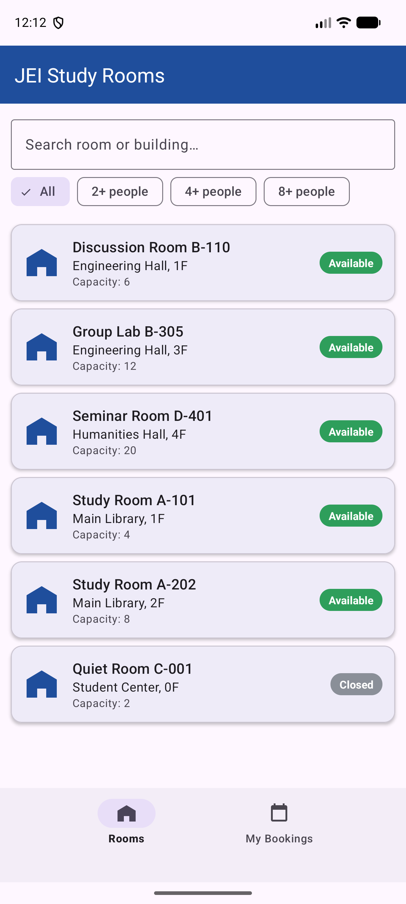
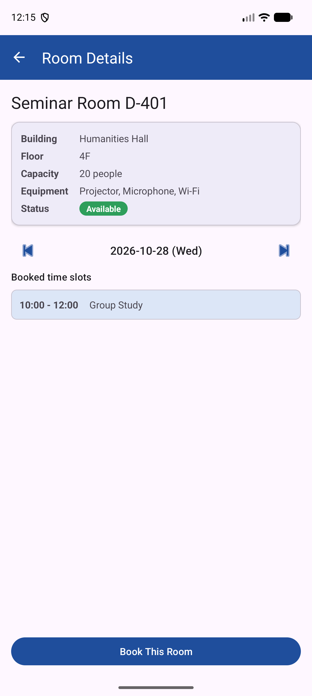
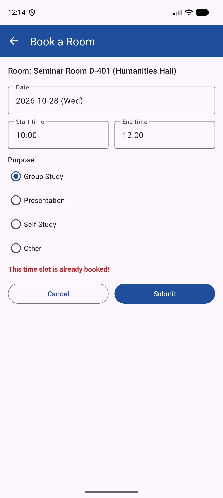
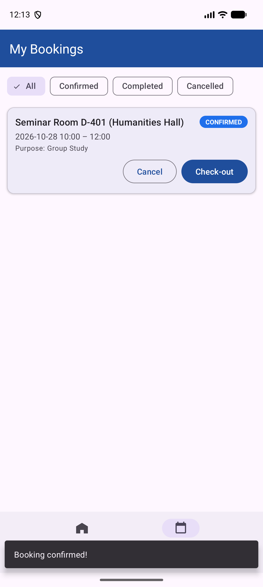

# JEI Smart Campus Study Room Booking App

Android midterm / final project for **JEI University** (Computer Software).
Students browse campus study rooms, see which time slots are already taken, and book a free slot.
Conflicting bookings are rejected automatically.

| | |
|---|---|
| **Student** | RAI SPANDAN (2025621055) |
| **Language / UI** | Kotlin, XML layouts with ViewBinding, Material 3 |
| **Architecture** | Fragment → ViewModel → Repository → Room DAO → SQLite |
| **Min / Target SDK** | 28 / 36 |

The planning & design document is in [`proposal.md`](proposal.md) and the database schema notes are in [`schema_notes.txt`](schema_notes.txt).

## Screens

| Rooms | Room details | Booking form | My bookings |
|:---:|:---:|:---:|:---:|
|  |  |  |  |

1. **RoomListFragment** – `RecyclerView` of rooms, search box, capacity filter chips.
2. **RoomDetailFragment** – room info, day selector, `RecyclerView` of booked time slots.
3. **BookingApplyFragment** – date / time pickers, purpose, validation and conflict check.
4. **MyBookingsFragment** – booking history with status filter, **Cancel** and **Check-out**.

Navigation uses a single `MainActivity`, a `NavHostFragment` and `nav_graph.xml`
(`RoomList → RoomDetail → BookingApply → MyBookings`) plus a bottom navigation bar.

## Database (Room, `campus_booking_database`)

| Table | Purpose |
|---|---|
| `users` | students / admins |
| `study_rooms` | bookable rooms (building, floor, capacity, equipment, availability) |
| `reservations` | bookings; FK → `users.user_id` and `study_rooms.room_id` |

Sample users and rooms are inserted the first time the database is created
(see `AppDatabase.kt`). The app currently runs as the demo student `user_id = 1`
(there is no login screen yet).

Booking rules (checked in `BookingViewModel` / `BookingRepository`):
date not in the past, end after start, max 3 hours, room must be open, and no overlap
with another `CONFIRMED` booking of the same room (check + insert run in one transaction).

## Project structure

```
app/src/main/java/com/jei/campusbooking/
├── MainActivity.kt
├── data/
│   ├── AppDatabase.kt          Room database + seed data
│   ├── entity/                 User, StudyRoom, Reservation, ReservationDetail
│   ├── dao/                    UserDao, StudyRoomDao, ReservationDao
│   └── repository/             RoomRepository, BookingRepository
├── ui/
│   ├── rooms/                  RoomListFragment, RoomListViewModel, RoomAdapter
│   ├── detail/                 RoomDetailFragment, RoomDetailViewModel, TimeSlotAdapter
│   ├── booking/                BookingApplyFragment, BookingViewModel
│   └── mybookings/             MyBookingsFragment, MyBookingsViewModel, BookingAdapter
└── util/                       DateUtil, PasswordUtil, SessionManager
```

## Build & run

Requirements: Android Studio (or JDK 17+ and the Android SDK with API 36.1).

```bash
./gradlew assembleDebug        # build  (Windows: gradlew.bat assembleDebug)
./gradlew installDebug         # install on a running emulator / device
```

Or open the folder in Android Studio and press **Run**.
`local.properties` (SDK path) is created by Android Studio and is not committed.

## Roadmap

- [x] Rooms list with search and capacity filter
- [x] Room details with booked slots per day
- [x] Booking form with validation and conflict check
- [x] My bookings: cancel / check-out
- [ ] Login / sign-up screen using the `users` table
- [ ] Admin: open / close rooms
- [ ] Unit and UI tests

## AI disclosure

Cursor AI was used to assist in structuring the project proposal, drafting the Room DB schema
and scaffolding the app code. All content was reviewed, tested on an emulator and validated by the student.
